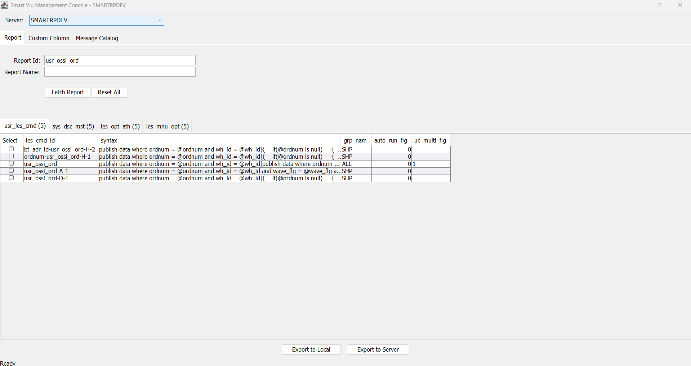
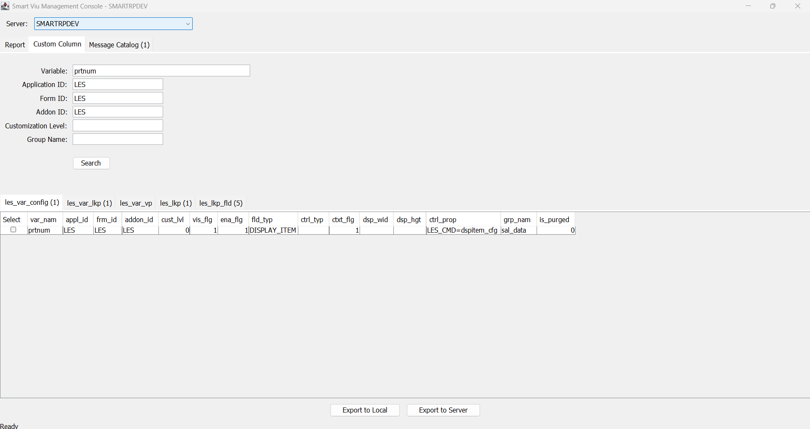
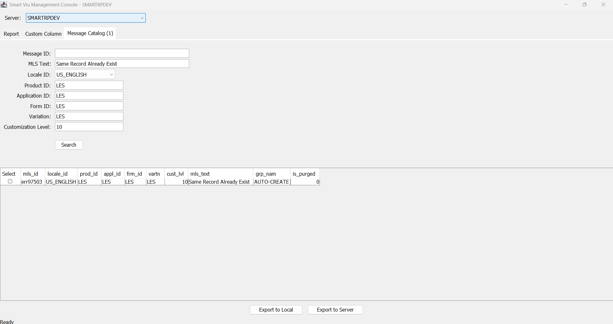

# SmartViu Management Console

## Overview

The SmartViu Management Console is a utility in the Smart MOCA Client that allows developers and administrators to **view SmartViu metadata** stored in a MOCA environment. SmartViu metadata is the configuration data that defines SmartViu reports, custom columns and message text. The console retrieves this data from the environment's database, presents it in grids for review, and exports it as CSV files.

The console covers three areas of metadata, each on its own screen (tab):

| Screen | Metadata area | Purpose |
|---|---|---|
| **Report** | SmartViu reports | Displays the records that define a report: its command, description, authorization and menu option |
| **Custom Column** | Custom columns (variables) | Displays the configuration of a variable together with its lookups and lookup fields |
| **Message Catalog** | Messages and translations | Displays catalog messages and their translated text by locale |

The console is read-only. It does not insert, update or delete database rows. The only artifacts it creates are the CSV files produced by an export.

## Launching the SmartViu Management Console

The console is available from the **Addons** menu of the Smart MOCA Client and requires an active connection to a MOCA server.

1. Connect to a MOCA server in the Smart MOCA Client.
2. Select **Addons > Smart Innovations > Smart Viu Management Console**.


The console opens in its own window. The window title shows the name of the server in use, for example *Smart Viu Management Console - SMARTRPDEV*.

### Selecting a Server

The **Server** list at the top of the window determines which MOCA server the console reads metadata from and exports to. It is preselected with the server to which the Smart MOCA Client is connected, and it also contains the servers saved in the client.

When you select a different server, the console connects to it, requesting login credentials if none are saved. If results are already displayed, the console asks you to confirm before it clears them. The values entered in the search fields are retained. If the connection cannot be established, the previous server and its results remain in place.

## Report Screen

The Report screen retrieves a SmartViu report and the records that define it. A report can be located by its identifier, by its name, or by both.



### Search Fields

| Field | Input | Description |
|---|---|---|
| **Report Id** | Multiple values | Identifier of the report. Compared with the report command identifier and the option name in the report tables |
| **Report Name** | Multiple values | Name of the report, compared with the descriptive text in `sys_dsc_mst` |

To search for more than one value in a field marked **Multiple values**, separate the values with commas, for example `UC-A, UC-B`. Spaces around a value and empty entries are ignored, a value entered more than once is applied once, and each field accepts up to 100 values.

### Buttons

| Button | Description |
|---|---|
| **Fetch Report** | Searches the report tables using the entered values |
| **Reset All** | Clears the Report Id and Report Name fields, restores the default values on the Custom Column and Message Catalog screens, and clears all results. The selected server is not changed |

### How It Works

The results are displayed on four tabs, one for each of the tables `usr_les_cmd`, `sys_dsc_mst`, `les_opt_ath` and `les_mnu_opt`. Each tab title shows the number of rows retrieved.

* **Report Id entered.** All four tables are searched for the entered identifier. If a **Report Name** is also entered, it further restricts the `sys_dsc_mst` results.
* **Only Report Name entered.** The console first retrieves the matching `sys_dsc_mst` records and derives the report identifiers from them. It then retrieves the corresponding `usr_les_cmd`, `les_opt_ath` and `les_mnu_opt` records.

## Custom Column Screen

The Custom Column screen retrieves the configuration of one or more variables, together with their lookups and lookup fields.



### Search Fields

| Field | Input | Default | Description |
|---|---|---|---|
| **Variable** | Multiple values (no 100-value limit) | Blank | Names of the variables to retrieve. This field must contain a value |
| **Application ID** | Single value | `LES` | Application to which the variable belongs |
| **Form ID** | Single value | `LES` | Form to which the variable belongs |
| **Addon ID** | Single value | `LES` | Add-on to which the variable belongs |
| **Customization Level** | Whole number | `10` | Customization level of the variable. A value that is not a whole number is ignored |
| **Group Name** | Single value | Blank | Group to which the variable belongs |

To retrieve more than one variable, enter the variable names in the **Variable** field separated by commas, for example `VAR_A, VAR_B`. Spaces around a name and empty entries are ignored, and a name entered more than once is applied once. After the search, the field displays the names as a cleaned, comma-separated list. All other fields on this screen accept a single value.

### Buttons

| Button | Description |
|---|---|
| **Search** | Searches the custom column tables using the entered values. Each search replaces the previous results |

### How It Works

The results are displayed on five tabs, one for each of the tables `les_var_config`, `les_var_lkp`, `les_var_vp`, `les_lkp` and `les_lkp_fld`. Each tab title shows the number of rows retrieved.

1. The console retrieves the records for the entered variable names from `les_var_config`, `les_var_lkp` and `les_var_vp`. The scope fields (Application ID, Form ID, Addon ID, Customization Level and Group Name) restrict these three tables.
2. It collects the lookup identifiers found in `les_var_lkp` and `les_var_vp`.
3. It retrieves the matching records from `les_lkp` and `les_lkp_fld`. The scope fields do not apply to these two tables.

## Message Catalog Screen

The Message Catalog screen retrieves messages from the message catalog and their translated text.



### Search Fields

| Field | Input | Default | Description |
|---|---|---|---|
| **Message ID** | Multiple values | Blank | Identifier of the message (`mls_id`) |
| **MLS Text** | Multiple values | Blank | Message text (`mls_text`) |
| **Locale ID** | Drop-down list | All | Locale of the translation. **All** retrieves messages for every locale |
| **Product ID** | Multiple values | `LES` | Product to which the message belongs |
| **Application ID** | Multiple values | `LES` | Application to which the message belongs |
| **Form ID** | Multiple values | `LES` | Form to which the message belongs |
| **Variation** | Multiple values | `LES` | Variation of the message |
| **Customization Level** | Whole number | `10` | Customization level of the message. A value that is not a whole number is ignored |

To search for more than one value in a field marked **Multiple values**, separate the values with commas, for example `LES, WMD`. Spaces around a value and empty entries are ignored, a value entered more than once is applied once, and each field accepts up to 100 values. **Locale ID** and **Customization Level** accept a single value.

The **Locale ID** list is populated from `locale_mst` on the selected server and is refreshed whenever the server changes. If the locales cannot be read, the list is replaced by a text box in which a locale identifier can be typed.

### Buttons

| Button | Description |
|---|---|
| **Search** | Searches the message catalog using the entered values |

### How It Works

The console searches the `les_mls_cat` table using the entered values. The results are displayed on the **Message Catalog** tab, whose title shows the number of rows retrieved. The columns returned are `mls_id`, `locale_id`, `prod_id`, `appl_id`, `frm_id`, `vartn`, `cust_lvl`, `mls_text`, `grp_nam` and `is_purged`.

## Exporting Data

Every screen provides two export actions at the bottom of the window: **Export to Local** and **Export to Server**. Both export the results of the most recent search on that screen, so a search must be run first. They differ only in the destination of the files: **Export to Local** writes to a directory on the computer running the Smart MOCA Client, and **Export to Server** writes to the load directory of the selected MOCA server.

### Selecting the Data to Export

* If one or more rows are selected in the **Select** column, only the selected rows are exported.
* If no rows are selected, all rows on all result tabs of that screen are exported.
* Tables with no rows to export are skipped.

### Export Output

Both export actions produce CSV files. For each table, a folder named `usr_smartviu_<table>` is created, and each exported row is written as a separate file in that folder. The file name consists of the primary key values of the row, joined by `__`, followed by the `.csv` extension. Characters that are not valid in file names are replaced.

```
usr_smartviu_usr_les_cmd/
    UC_PRTMST_MNT-AS-2.csv
usr_smartviu_sys_dsc_mst/
    les_cmd_id__UC_PRTMST_MNT-A-2_US_ENGLISH__10.csv
```

### Export to Local

**Export to Local** saves the metadata as files on the local machine, for example to keep a copy of a report definition or to move it by other means.

1. Run a search and, optionally, select the rows to export.
2. Click **Export to Local**.
3. In the **Choose a directory** dialog, select the destination directory. The directory is remembered as the default tables directory of the application.

The `usr_smartviu_<table>` folders are created inside the selected directory. When the export finishes, the console reports the number of tables exported and the destination directory.

### Export to Server

**Export to Server** transfers the metadata directly to the selected MOCA server, without a local destination dialog.

1. Run a search and, optionally, select the rows to export.
2. Confirm that the required server is selected in the **Server** list.
3. Click **Export to Server**.

The files are first created in a temporary folder on the local machine and then uploaded one at a time to the following location on the server. The `usr_smartviu_<table>` folder is created if it does not exist, and the temporary folder is deleted afterward.

`$LESDIR/db/data/load/base/bootstraponly/usr_smartviu_<table>/<file>.csv`

This operation requires permission to write files under the server's `$LESDIR`. When the export finishes, the console reports the number of files and tables uploaded and the destination server.

### Replacing Existing Files

Before writing, the console checks whether any of the files already exist in the destination, whether a local directory or the server. If so, it displays the **Replace existing files?** dialog, which shows the number of files, the destination and the first three file names. Select the "... and N more" link to view the complete list.

* **Yes** replaces the existing files.
* **No** cancels the export. No files are written. This is the default option.

Each export is also recorded in the log file `%APPDATA%\SmartMOCAClient\logs\smartviu-file-replacement.0.log`, which can be used to review which files were created or replaced.

**Note:** You also need permission to read the tables listed above. To use Export to Server, you need permission to write files under the server's `$LESDIR`.
