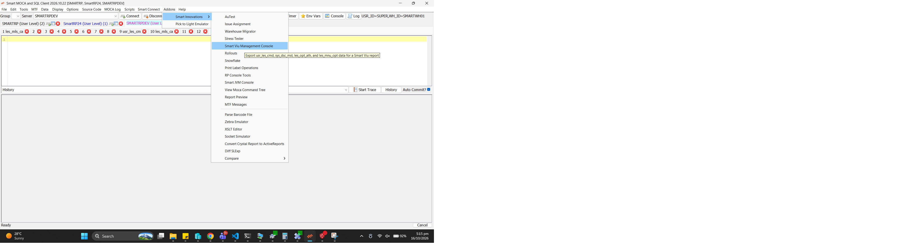
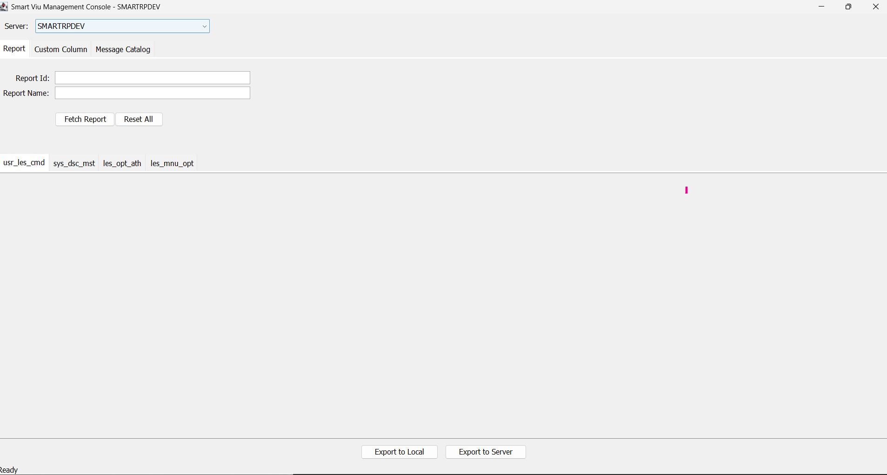
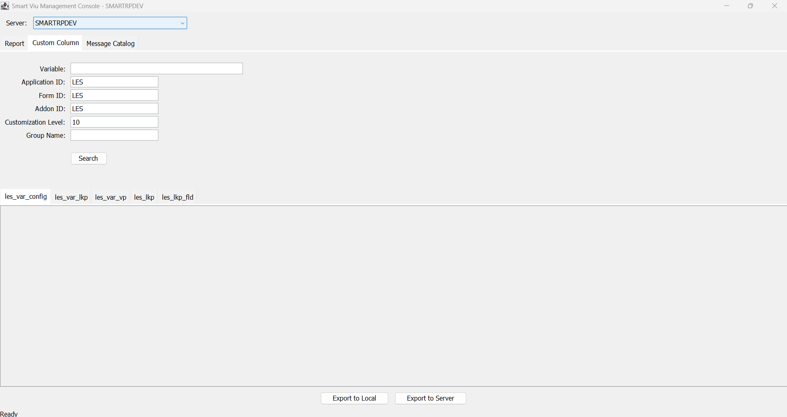
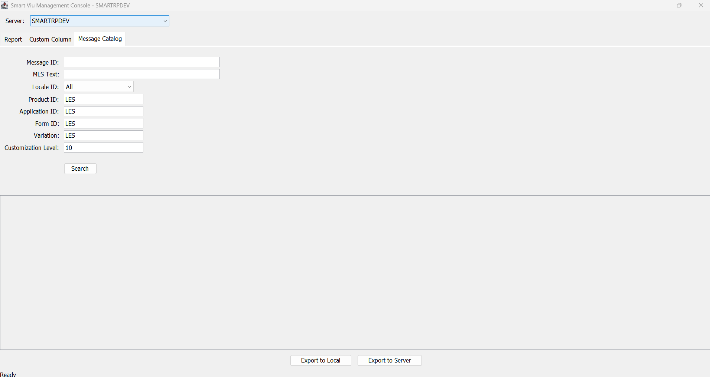

# Smart Viu Management Console

The Smart Viu Management Console is a screen in the Smart MOCA Client. It lets you look up Smart Viu configuration stored in a MOCA environment (reports, custom columns and messages), review it in grids, and export it as CSV files. The files can be saved to a folder on your computer or sent straight to a MOCA server.

The console only reads data. It never changes database rows. The only things it creates are the exported CSV files.

| Tab | Use it to find | Tables shown |
|---|---|---|
| **Report** | A report and the records that define it | `usr_les_cmd`, `sys_dsc_mst`, `les_opt_ath`, `les_mnu_opt` |
| **Custom Column** | A variable (custom column), its settings and lookups | `les_var_config`, `les_var_lkp`, `les_var_vp`, `les_lkp`, `les_lkp_fld` |
| **Message Catalog** | Messages and their translations | `les_mls_cat` |

## Before you start

The console needs the real MOCA client library, **`moca.jar`**, in the application folder next to `mocadev.jar`. If it is missing, searches stop with the message *"bind variables do not match on this server"*.

To add it, use either of these:

1. Copy `moca.jar` from any server's `MOCA\lib` folder into the application folder, then restart the application.
2. Connect to a server and choose **Tools > Download moca.jar**, then restart the application. This menu item appears only while `moca.jar` is not in use.

You also need permission to read the tables listed above. To use **Export to Server**, you need permission to write files under the server's `$LESDIR`.

## Opening the console

1. Connect to a MOCA server in the Smart MOCA Client.
2. Choose **Addons > Smart Innovations > Smart Viu Management Console**.



The console opens in its own window, on the server you are connected to.

## Features common to all screens

* **Server list.** The list at the top chooses the server the console reads from and exports to. It starts on the server you are connected to. If you change it while results are on screen, the console asks for confirmation and then clears the results. The values you typed in the fields are kept.
* **Several values in one field.** Where a field allows it, type values separated by commas. Spaces are ignored and repeated values are counted once. Most of these fields accept up to 100 values.
* **Result tabs.** Each table has its own tab in the results area. After a search the tab title shows the row count, for example `usr_les_cmd (28)`.
* **Select column.** The first column of every grid is a **Select** check box. It controls which rows are exported (see "Exporting data" below).
* **Background work.** Searches and exports run in the background, so the window stays responsive.
* **Errors.** If a query fails, a dialog lists the failed tables with the server's error text. The grids still show whatever could be read.
* **Status bar.** The bottom of the window shows the current status, for example *Ready*.

## Report screen

Use this screen to find a report by its id or name and see the records that define it.



### Fields

| Field | What to enter |
|---|---|
| **Report Id** | One or more report ids, separated by commas. Matches any id that *contains* the value |
| **Report Name** | One or more report names, separated by commas. Matches any name that *contains* the value |

Enter at least one of the two.

### Buttons

| Button | What it does |
|---|---|
| **Fetch Report** (or Enter in a field) | Runs the search |
| **Reset All** | Clears the Report Id and Report Name fields, puts the Custom Column and Message Catalog fields back to their defaults, and clears all results. The Server choice stays |

### How it works

* **With a Report Id**, the console searches all four tables for that id. If a Report Name is also given, it only narrows the `sys_dsc_mst` results.
* **With only a Report Name**, the console first finds matching rows in `sys_dsc_mst`, takes the report ids from them, and then looks those ids up in `usr_les_cmd`, `les_opt_ath` and `les_mnu_opt`.

Characters such as `%` and `_` are treated as ordinary text, not wildcards.

### Result tabs

| Tab | Contains |
|---|---|
| `usr_les_cmd` | The report command: id, syntax, group name and run flags |
| `sys_dsc_mst` | The report name and description text |
| `les_opt_ath` | Which roles can use the report |
| `les_mnu_opt` | The report's menu option |

If nothing is found, the message *No rows found for "..."* is shown.

## Custom Column screen

Use this screen to look up one or more variables (custom columns) with their settings and lookups.



### Fields

| Field | Default | Notes |
|---|---|---|
| **Variable** | (blank) | One or more variable names, separated by commas. Required. Exact match |
| **Application ID** | `LES` | Exact match |
| **Form ID** | `LES` | Exact match |
| **Addon ID** | `LES` | Exact match |
| **Customization Level** | `10` | Must be a whole number, otherwise it is ignored |
| **Group Name** | (blank) | Exact match |

A blank field is not used as a condition.

### How it works

Click **Search** (or press Enter in the Variable field). The console reads the variable's configuration, its lookups and its value providers using the names and scope fields above. It then collects the lookup ids found and loads the matching lookup records and lookup fields. Each search replaces the previous results.

### Result tabs

| Tab | Contains |
|---|---|
| `les_var_config` | The variable's configuration |
| `les_var_lkp` | Lookups attached to the variable |
| `les_var_vp` | Value providers of the variable |
| `les_lkp` | The lookup definitions used by the variable |
| `les_lkp_fld` | The fields of those lookups |

The Application ID, Form ID, Addon ID, Customization Level and Group Name fields apply to the first three tabs only. `les_lkp` and `les_lkp_fld` are found through the lookup ids.

## Message Catalog screen

Use this screen to search messages and their translations.



### Fields

| Field | Default | Notes |
|---|---|---|
| **Message ID** | (blank) | Several values. *Contains* match |
| **MLS Text** | (blank) | Several values. *Contains* match |
| **Locale ID** | All | Drop-down filled from the server. **All** does not filter by locale |
| **Product ID** | `LES` | Several values. Exact match |
| **Application ID** | `LES` | Several values. Exact match |
| **Form ID** | `LES` | Several values. Exact match |
| **Variation** | `LES` | Several values. Exact match |
| **Customization Level** | `10` | Whole number, otherwise it is ignored |

A blank field is not used as a condition. If the console cannot read the locale list from the server, the Locale ID drop-down becomes a text box where you can type a locale id.

### How it works

Click **Search** (or press Enter in Message ID or MLS Text). The matching rows are shown in the **Message Catalog** result tab, with the row count in its title. If nothing is found, the message *No rows found in Message Catalog* is shown.

## Exporting data

Each screen has two buttons at the bottom: **Export to Local** and **Export to Server**. Run a search first. If there are no results, the console tells you to search first.

### What gets exported

* If you tick the **Select** check box on some rows, only the ticked rows are exported.
* If no rows are ticked, all rows from all result tabs are exported.
* Tables with no rows are skipped.

### Folders and files

Each table gets its own folder, `usr_smartviu_<table>`. Each exported row becomes one CSV file in that folder. The file name is made from the row's primary key values, joined with `__`.

```
usr_smartviu_usr_les_cmd/
    UC_PRTMST_MNT-AS-2.csv
usr_smartviu_sys_dsc_mst/
    les_cmd_id__UC_PRTMST_MNT-A-2_US_ENGLISH__10.csv
```

If the console finds that two rows would get the same file name, it stops and writes nothing.

### Export to Local

1. Click **Export to Local**.
2. Choose a folder in the **Choose a directory** dialog.
3. The table folders are created inside it. A message confirms how many tables were exported.

### Export to Server

1. Choose the target server in the **Server** list.
2. Click **Export to Server**. No folder dialog appears.
3. The files are uploaded to this folder on the server:

   `$LESDIR/db/data/load/base/bootstraponly/usr_smartviu_<table>/<file>.csv`

4. A message confirms how many files were uploaded.

### Replacing existing files

If any file already exists in the target folder, a **Replace existing files?** dialog shows how many files are affected and the first few names. Click the "... and N more" link to see the full list.

* **Yes** replaces the files.
* **No** (the default) cancels the export and nothing is written.

Each export is recorded in a log file at `%APPDATA%\SmartMOCAClient\logs\smartviu-file-replacement.0.log`, so you can check later what was replaced.

## Common messages

| Message | What to do |
|---|---|
| Choose a server in the Server list first | Pick a server in the Server list |
| Could not connect to `<server>` | Check the server and password, then try again |
| Enter a Report Id or Report Name | Fill in at least one of the two fields |
| Enter a Variable Name | Fill in the Variable field |
| Enter at most 100 ... | Use fewer comma-separated values |
| No rows found ... | Widen the search |
| Some queries failed, so the data shown may be incomplete | Read the table name and error text listed in the dialog |
| Bind variables do not match on this server | `moca.jar` is missing. Add it as described in "Before you start" and restart the application |
| Export cancelled. No files were written | You chose **No** in the replace dialog. Run the export again and choose **Yes** |
